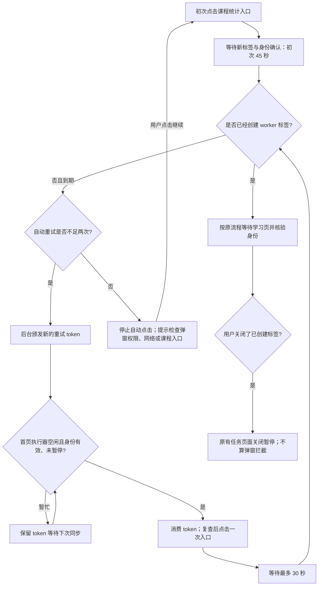
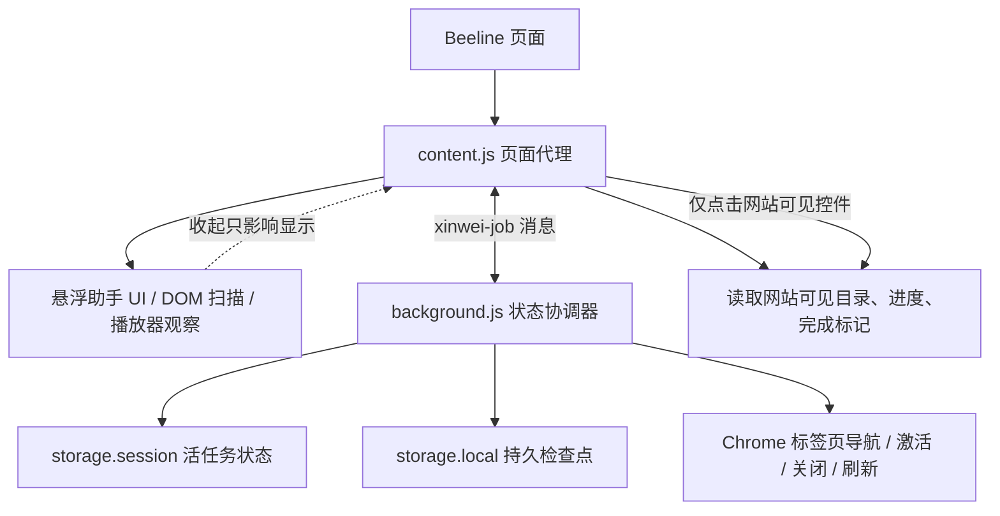
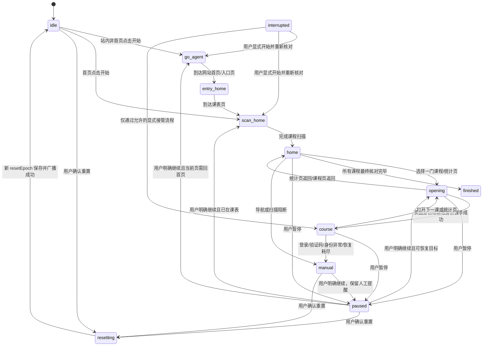
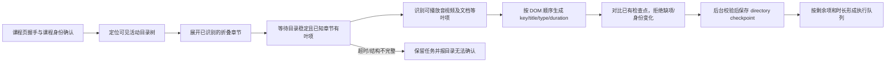

# Xinwei Course Watcher 运行逻辑图

原始图基准：分支 `feature/ui-floating-assistant-orbit`，提交 `a373081`（2026-10-24）。以下保留原图，并补充 2026-10-25 的统计页打开恢复分支。业务代码入口主要在 `content.js` 和 `background.js`；测试索引见 [`TEST-MAP.md`](TEST-MAP.md)。

## 统计页未打开：有界重试（2026-10-25 补充）



时间为逻辑期限；轮询、浏览器后台节流或休眠可能推迟实际检查。不能仅凭未出现新页断定浏览器拦截，因此提示也包含网络/入口检查。弱网播放器仍按原有资源重试和暂缓流程处理，只补充明确原因及人工检查建议。

## 总览



### 职责边界

- `content.js`：运行在网站顶层文档，负责 DOM 识别、UI、课程/资源执行、媒体事件观察和向后台发消息。它不拥有跨页面任务的最终权威状态。
- `background.js`：MV3 service worker，负责任务检查点、标签页身份、阶段迁移、消息校验、导航/刷新授权、取消栅栏和广播。它不调用课程网站 API。
- `manifest.json`：限定扩展注入的网站范围及本地悬浮球图片资源；没有新增课程站点之外的注入范围。
- `tests/*.test.cjs`：Node test runner + jsdom 合成页面，验证分支和消息协议；不等同真实网站验收。

## 后台任务状态机

阶段名称来自 `background.js`。状态迁移受当前阶段、`runId`、`generation`、owner 标签/文档、课程身份及取消检查共同约束。



纯文字顺序：

```text
idle
  -> go-agent（需要导航到已观察的站点入口）
  -> entry-home（识别真实课表入口）
  -> scan-home（扫描正在上的课程及分页）
  -> home（按剩余待处理音视频数选择目标）
  -> opening（统计页或播放课程页）
  -> course（身份/目录核对，单遍播放、课程末核对）
  -> opening/home（返回或打开下一门）
  -> finished（所有扫描课程均已最终核对）

任何运行阶段 -> paused（用户暂停）或 manual（平台/身份/安全阻断）
浏览器/扩展重启 -> interrupted（只恢复检查点，不自动开始播放）
用户确认重置 -> resetting -> idle（resetEpoch 隔离旧消息）
```

## 正常任务主路径

1. 页面加载：`injectUI()` 创建悬浮球和原面板；启动路由同步、任务同步、目录只读刷新及媒体观察。
2. 用户按“开始”：`start()` 等待播放目标设置读写完成，发 `start`；后台确认来源、当前标签和任务身份，创建新任务或显式恢复已有任务。
3. 后台通过已确认的站点页面进入首页/课表；首页扫描只采集“正在上课”的卡片，分页等待卡片实际更新。
4. 后台持久化候选课程及身份。普通课程选择按剩余音视频数量少优先；首页统计与课程播放分开。
5. 打开目标课程后，content 脚本先验证课程 key，再等待目录结构稳定、展开必要章节并生成目录快照。
6. 每个资源需通过唯一目录 key 和精确路由检查后才能操作。按可处理媒体、完成标记、既有未完成记录及模式建立播放/核对顺序。
7. 单遍模式先播放未确认资源，再做课程末核对；页面完成标记/观看百分比是平台证据，不能伪造自然播放结束。
8. 结果、人工项、目录和播放断点回传后台。跨课程导航只能依据已经校验的课程入口。
9. 任务结束时明确表示音视频核对结果；不把音视频完成等同整门课程完成。

## 目录统计：根因与防线



- 已确认的具体根因：目标 Beeline 页面实际渲染了 40 个 `.section-content` 项，但没有 `li.el-menu-item`。旧就绪检查只等待后者，已载入目录一直被当成未载入，最终目录统计超时。
- 当前修复：目录 root 限定在可见活动树；章节就绪看真实识别到的叶项；忽略隐藏的响应式副本；从真实行容器读取标题、时长和完成标记。代码位置：`content.js` 的 `findDirectoryRoot()`、`getMenuItems()`、`knownChaptersHaveItems()`、`getStatusHost()`；提交 `a373081`。
- 该修复解决已复现页面结构不匹配，不证明平台所有课程模板都一致。新模板、异步延迟、空章节语义仍需 fixture/真实页覆盖。

## 播放与完成语义

- 资源身份由课程 key、目录 item key、标题/类型和已观察资源路由共同组成；只有已保存目录中的唯一音视频项可成为播放断点。
- 页面“已观看百分比”或完成图标是平台确认信号；自然结束是另一种独立证据。播放目标 80%–100% 仅影响单遍处理策略，不代表 80% 自动等同自然结束。
- 不写播放器进度、不改倍速、不调用媒体播放 API、不合成 `ended`。播放只通过页面可见的大播放控件操作。
- 资源未自然结束、自然结束但平台未确认、跳进度造成缺口、失败待重试等状态会留下未完成义务，不能因目录暂时缺项而跳过。
- 单项恢复、课程末重试、课程刷新和整轮导航恢复有不同预算与检查点；尝试必须具备 token/episode/课程/资源身份约束。

## 暂停、刷新、中断、重置

```text
用户暂停
  -> content 立即使本地 epoch 失效并暂停媒体
  -> 后台 cancellation fence 抢在队列消息前阻止浏览器操作
  -> generation 前进、保存 paused/manual、广播
  -> 迟到的 start/hello/恢复授权因 runId/generation/owner 校验失败

资源中断
  -> content 检测路由/媒体异常，取消旧执行器
  -> 后台建立 interruption episode，最多三次
  -> 普通恢复优先；必要时导航到已校验课程/资源入口
  -> 新页面 hello 不能仅凭地址栏接管，还需课程、文档、资源身份核对
  -> 连续自然推进与位置证据核验后才清零恢复预算

刷新/扩展重启
  -> service worker 读取 session/local 检查点
  -> 磁盘检查点只恢复为 interrupted，不自行续播
  -> 用户显式开始后再握手、核对目录与资源断点

重置
  -> 用户确认后本地同步停止播放和执行器
  -> 后台 resetEpoch 前进，先保存 resetting/reset 状态
  -> 广播取消旧任务页；旧 epoch 消息不得重建旧任务
  -> 清理成功才回 idle，失败保持停止并要求重试
```

关键防竞态字段：`runId`（任务身份）、`generation`（执行授权代数）、`revision`（持久化版本）、`resetEpoch`（重置栅栏）、`ownerTabId/ownerInstance`（执行文档身份）、`retiredInstances`（旧文档退休表）、`cancellationFence`（队列外即时取消）。

## UI 与任务隔离

- 默认显示 `#wb-assistant-button` 图片按钮；展开/收起只切换 `hidden`、位置和广告可见性。
- 原面板 DOM、按钮 ID、开始/暂停/重置与课程业务处理器保留。UI 收起不会调用 `stop()`、`pauseMedia()` 或任务状态转换。
- 拖动使用 pointer 身份和 6px 阈值；鼠标点击与拖动分开，位置按 visual viewport 约束。
- 广告是独立 `PROMOTION_CONFIG`/`createPromotion()` 模块；单条 SVG textPath 沿圆角矩形轨道，层级对课程 UI 非阻塞，点击文本才由用户主动打开外站。关闭推广只隐藏该层。
- 可查代码：UI `content.js:1217-1923`；目录 `content.js:1925-2393`；开始/暂停/重置 `content.js:4358-4500`；后台协调 `background.js:1031-1760`。

## 状态核对规则

读代码或排错时按以下顺序定位，避免先追下游恢复逻辑：

1. **页面结构**：当前页面路由、DOM 文本/节点、可见目录 root 和叶项数是否正确。
2. **目录判定**：章节是否展开、稳定检查是否使用该站点实际叶项结构、隐藏副本是否过滤。
3. **快照身份**：key/title/type/duration 与课程/教学班身份是否自洽，是否出现部分目录。
4. **后台检查点**：`directory-checkpoint` 是否通过 owner、courseKey、快照 schema、旧项完整性校验。
5. **执行队列**：只有完整且已保存的目录才进入播放/核对队列。
6. **播放及恢复**：仅当 1–5 已通过，才调查媒体事件、自然结束、平台完成标记、interruption/retry。

如果第 1–4 步失败，之后显示的“自动恢复失败/任务停止”通常只是保护行为，不是最初原因。
